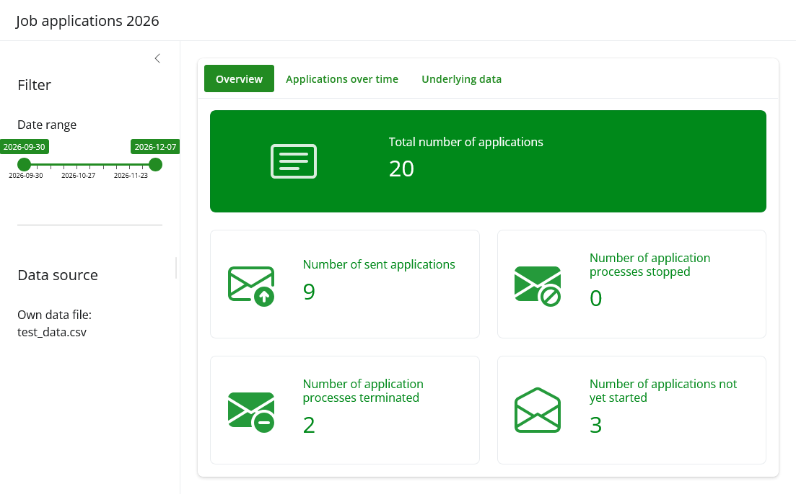
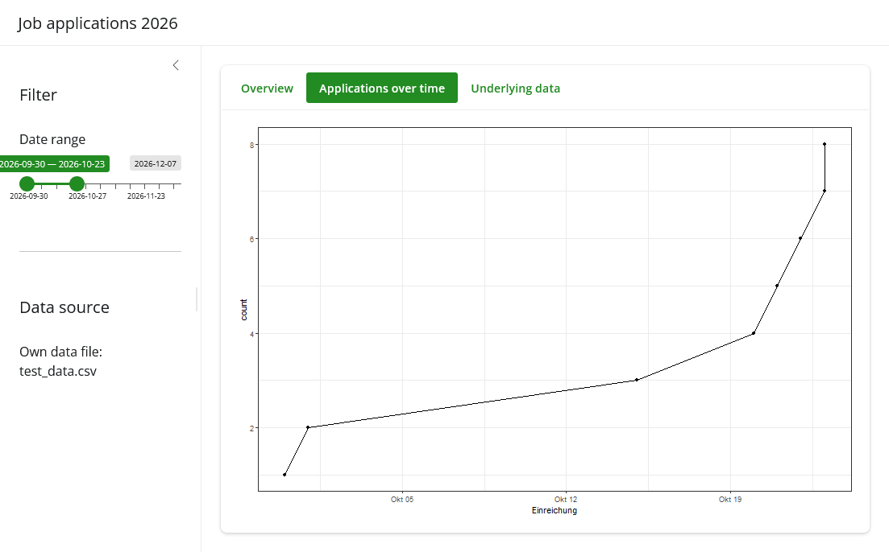
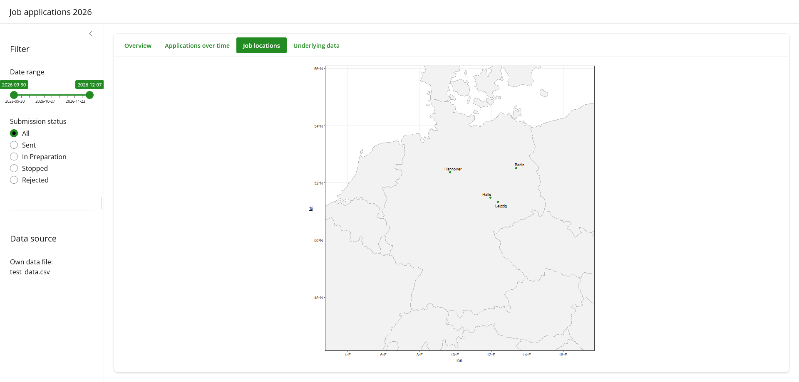
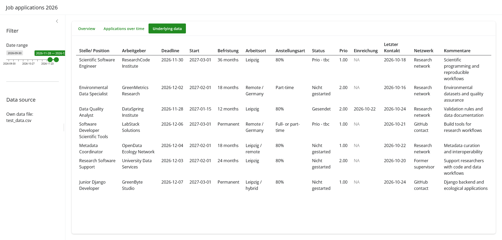
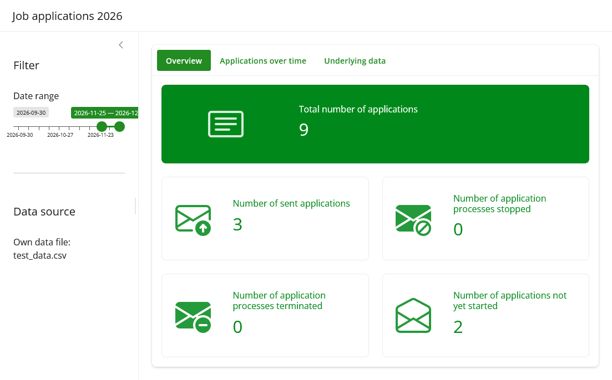

# Job application Dashboard

Overview of job applications that were sent out or in preparation. The goal is to provide a dashboard using RShiny that highlights some stats about the application progress and interesting figures.




## Installation

Download the repository from GitHub. If relevant, unzip the downloaded folder. Open the project file [job-applications-shiny.Rproj](job-applications-shiny.Rproj).


## Tech Stack

- Platform: x86_64-w64-mingw32/x64 (Windows)
- RStudio 2026.10.1
- R 4.5.2
  - RShiny (shiny_1.14.0)
  - bslib_0.10.0 and bsicons_0.1.2
  - googlesheets4_1.1.2 and its dependency googledrive_2.1.2
  - dotenv_1.0.3
  - ggplot2_4.0.3, readr_2.2.0, dplyr_1.2.1, and lubridate_1.9.5


## Usage/Examples

1.  Create an .env file using the .env.example. In most cases, you will just have to copy-paste the content of this file.

2.  Open the Project file if not done yet: [job-applications-shiny.Rproj](job-applications-shiny.Rproj).

3.  Click on `Run App` in Rstudio or use the following command

``` r
shiny::runApp()
```

### Screenshots (fake data)









### Options

If you wanna load your own csv file with application data, please consider the following:

1.  Update the .env file to consider your own file: `OWN_DATA_FILE="your-file-name.csv"`.

2.  Make sure that you have the same columns names, or that you change the columns names in the R scripts. The second option requires more work, as you will have to check all .R files.

In case of issues with date columns, try to check their date format. In the example, we use dates like 2026-02-03.


## Running Tests

To run tests, run the following command

``` r
shiny::runApp()
```


## Features

- Value boxes showing interesting counts
- Filter for submission status that effects all shown figures and graphs
- Line graph with number of applications over time
- Adjustable date range to view application numbers, graph and table in certain time intervals
- Map showing job locations
- Exchangeable data input depending on user permission and provided data files
- Data table to view information about applications




## Contributing

This is a personal learning project and is not open to contributions. Thank you for your understanding.


## Authors

- [\@JeMaNd-r](https://www.github.com/JeMaNd-r)


## Acknowledgements

Readme template was taken from [Readme.so](https://readme.so/editor).

Coordinates obtained from the city articles on Wikipedia (English and German editions), accessed 29 October 2026. Wikipedia contributors; coordinate values converted from degrees/minutes/seconds to decimal degrees where applicable.


## License

[MIT](LICENSE)
